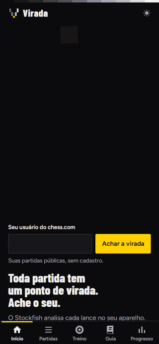
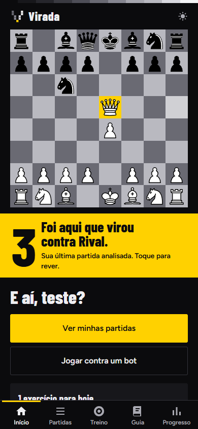
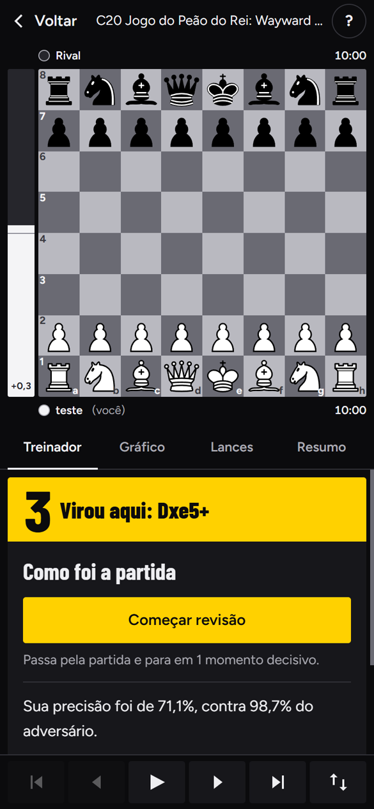
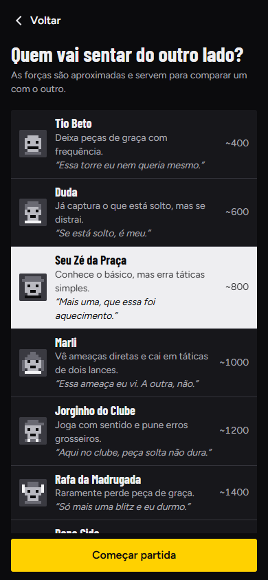
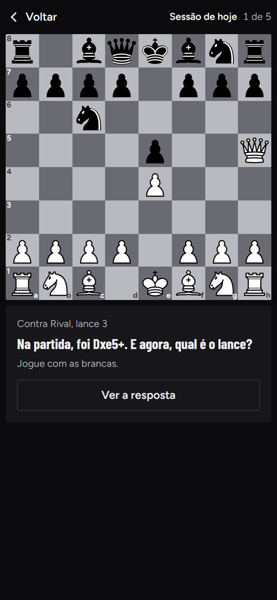
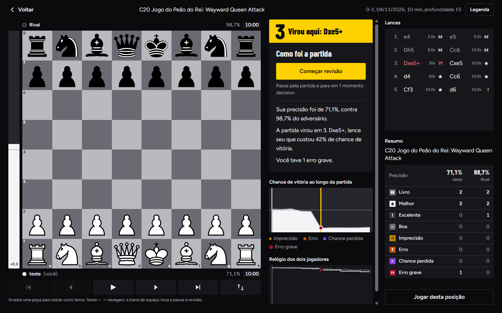

<div align="center">


# Virada

**Toda partida tem um ponto de virada. Ache o seu.**

Um treinador de xadrez grátis, em português, que analisa suas partidas do chess.com com o Stockfish rodando no seu próprio aparelho.

Sem cadastro. Sem assinatura. Sem servidor. Seus dados ficam com você.

**[Abrir o Virada](https://virada-kappa.vercel.app)**



</div>

## Por que existe

Você acabou de perder. Ainda está com o celular na mão e só quer saber uma coisa: **onde foi que a partida virou?**

O Virada acha esse lance, explica em português o que aconteceu, com a voz do Seu Nonato, um velho de boteco que joga melhor que você, e transforma o seu erro em exercício. Da próxima vez, você reconhece a posição.

## O que ele faz

| | |
|---|---|
| **Acha a virada** | Classifica cada lance e, na revisão guiada, para nos momentos que decidiram a partida. |
| **Abre com história** | A tela inicial mostra uma de 120 jogadas de partidas reais, da Imortal de 1851 aos dias de hoje, com o Seu Nonato comentando. Os lances vêm da base [PGN Mentor](https://www.pgnmentor.com). |
| **Classifica como o Chess.com** | Brilhante, Excelente, Melhor, Ótimo, Bom, Livro, Imprecisão, Erro, Chance perdida e Erro grosseiro. Os pontos esperados dependem do rating, com uma curva medida em 157 mil partidas reais. [Como funciona](docs/classificacao.md). |
| **Explica de verdade** | Peça sem defesa, garfo, cravada, mate perdido: o erro é explicado em português, com as linhas do Stockfish. |
| **Revisão guiada** | Passa pela partida sozinho, em quatro velocidades, e para nos momentos decisivos. |
| **Treina os seus erros** | Seus piores lances viram exercícios com repetição espaçada, numa sessão diária com sequência de dias. |
| **Doze adversários** | Do Tio Beto ("Essa torre eu nem queria mesmo.") ao Stockfish sem limites, com treinador ao lado, dica, relógio opcional e início de qualquer posição. |
| **Guia de aberturas** | 3.865 linhas no catálogo, 41 aberturas explicadas com planos e armadilhas, repertório e prática lance a lance. |
| **Caminho de aulas** | 36 aulas em quatro níveis, do zero ao cálculo. O Seu Nonato mostra no tabuleiro, passo a passo, e você pratica em seguida. Com vídeos opcionais. [Como funciona](docs/aprendizado.md). |
| **Motor no servidor** | A partida inteira é analisada com o Stockfish completo, e se ele não responder o aparelho assume. [Como funciona](docs/motor-servidor.md). |
| **Puzzles** | Aleatórios sem fim, puzzle do dia e 22 temas em quatro dificuldades. |
| **Seu progresso** | Rating, precisão e erros por período e ritmo, e o que se repete: "6 dos 9 erros graves foram garfos no meio-jogo". |
| **Sem internet** | Instala como app e continua funcionando offline, inclusive a análise. |

## Telas

<div align="center">




</div>

<div align="center">

</div>

## Como rodar

Você precisa do [Node.js](https://nodejs.org) 22.13 ou mais novo.

```bash
git clone https://github.com/Joaopedrotavaress/virada.git
cd virada
npm install
npm run dev
```

O `npm install` copia o Stockfish para `public/engine` e gera a base de aberturas.

Para abrir no celular durante o desenvolvimento, com os dois na mesma rede:

```bash
npm run dev -- --host
```

Para rodar os testes, que usam o motor de verdade e conferem cada lance do guia com as regras e com o Stockfish:

```bash
npm test
```

## Publicar

Na Vercel, importe o repositório, mantenha o que ela detectar (Vite, `npm run build`, pasta `dist`) e clique em **Deploy**. Não há variável de ambiente nem servidor para configurar.

## Opcionais

**Computador local.** O comando abaixo abre o mesmo app em `http://127.0.0.1:4300`, com uma cópia dos dados num SQLite e a análise em lote usando o motor completo. Só este computador tem acesso, e o site publicado não depende disso.

```bash
npm run local
```

**Entre aparelhos.** Na tela Seus dados, dá para salvar um backup em arquivo ou sincronizar por um gist secreto com um token seu do GitHub. Um gist secreto não é criptografado: quem tiver o link consegue ler.

## Por dentro

React, TypeScript, Vite e Tailwind. O Stockfish roda em WebAssembly num Web Worker, os dados ficam no IndexedDB e o app funciona como PWA. A identidade visual está em [DESIGN.md](DESIGN.md).

## O que é bom saber

- **Força dos bots:** os números são aproximados e servem para comparar os níveis. Não foram medidos contra jogadores.
- **Textos do guia:** cada lance citado foi conferido pelas regras e pelo Stockfish, mas as explicações de plano não foram revisadas por um jogador forte. Se achar um erro, abra uma issue.
- **Profundidade:** a análise Rápida pode deixar passar táticas longas.

## Créditos

Feito sobre o trabalho aberto de muita gente: [Stockfish.js](https://github.com/nmrugg/stockfish.js), [chess.js](https://github.com/jhlywa/chess.js), [react-chessboard](https://github.com/Clariity/react-chessboard) e as bases abertas de aberturas e puzzles do [Lichess](https://lichess.org). A lista completa está em [CREDITS.md](CREDITS.md).

Licença [GPL-3.0](LICENSE).

<div align="center">

**Feito com carinho no Brasil.**

</div>
